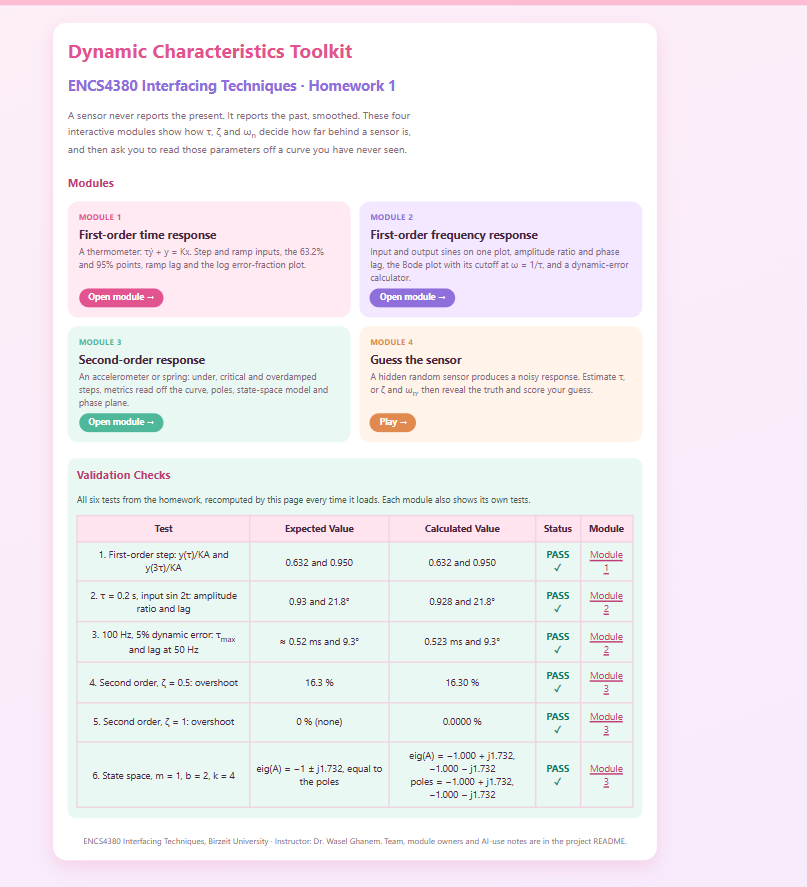
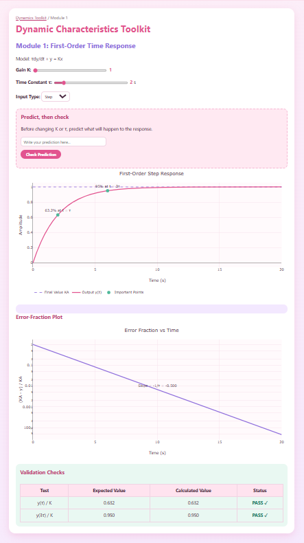
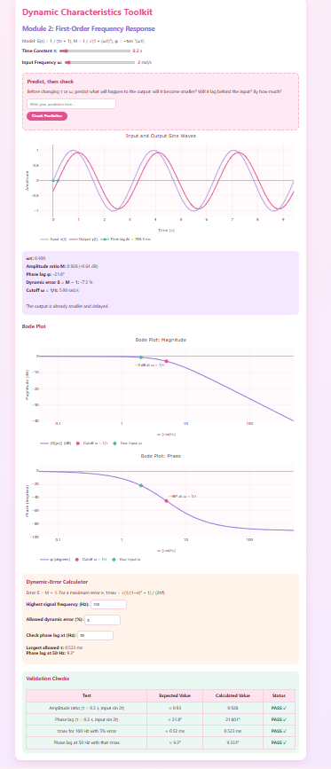
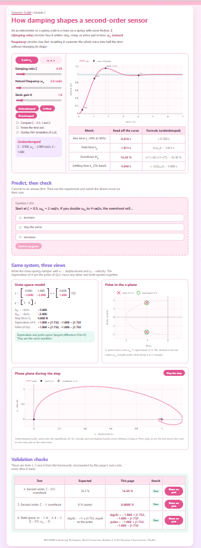
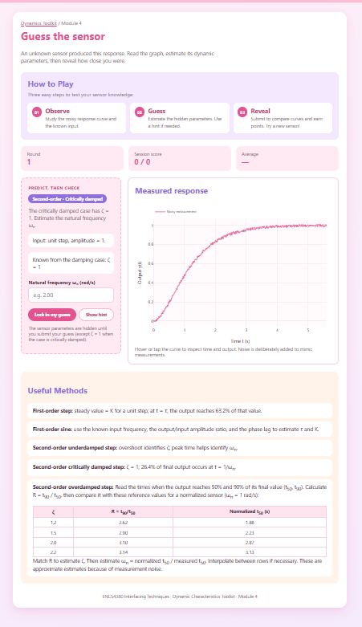

# Dynamic Characteristics Toolkit

**ENCS4380 Interfacing Techniques · Homeworks 1 & 2 · Birzeit University**
Instructor: Dr. Wasel Ghanem

An interactive web toolkit that shows how a sensor's dynamic characteristics (τ, ζ and ω<sub>n</sub>) decide how far behind the real world it is. Everything runs live in the browser: move a slider and every plot redraws instantly.

## 🔗 Live site

**https://batool2006bsharat-cyber.github.io/encs4380-dynamics-Jerry/**

Works on desktop and phone. No server, login or installation needed.

## 👥 Team: Jerry

| Member | Student ID | Homework 1 module |
|---|---|---|---|
| Batool Bsharat | 1230049 | Module 1: First-order time response |
| Hala Qunir | 1231745 | Module 2: First-order frequency response |
| Basamat Yasin | — | Module 3: Second-order response |
| Niveen Antari | 1232976 | Module 4: Guess the sensor |

## 📦 Homework 1 — Dynamic Characteristics

### Files and modules

| File | Content |
|---|---|
| `index.html` | Home page: links to the four modules and all six validation checks |
| `module1.html` | First-order time response |
| `module2.html` | First-order frequency response |
| `module3.html` | Second-order response and state-space panel |
| `module4.html` | "Guess the sensor" challenge |

### Module 1: First-order time response (thermometer)
Model: τẏ + y = Kx, G(s) = K/(τs + 1)
- Sliders for K and τ, input type step or ramp.
- Step: markers at the 63.2% point (t = τ) and the 95% point (t = 3τ).
- Ramp: ramp lag = τ and steady-state error = Kτ.
- Error-fraction plot (K − y)/K on a log axis: a straight line with slope −1/τ.
- "Predict, then check": 5 multiple-choice questions. After answering, "Run the experiment" moves the sliders on their own to show the result.

### Module 2: First-order frequency response
Model: M = 1/√(1 + (ωτ)²), φ = −tan⁻¹(ωτ)
- Sliders for τ and input frequency ω.
- Input and output sines on one plot, with the time lag marked.
- Amplitude ratio (also in dB), phase lag and dynamic error δ = M − 1.
- Bode magnitude and phase plots with the cutoff marked at ω = 1/τ (−3 dB, −45°).
- Dynamic-error calculator: largest allowed τ for a given frequency and error, and the phase lag at a chosen frequency.

### Module 3: Second-order response (accelerometer, spring)
Model: G(s) = Kω<sub>n</sub>²/(s² + 2ζω<sub>n</sub>s + ω<sub>n</sub>²)
- Two parameter sets: ζ, ω<sub>n</sub>, K, or the physical m, b, k.
- Underdamped, critically damped and overdamped presets, plus an overlay comparing ζ = 0.3, 1 and 2.
- Rise time, peak time, overshoot and settling time **read off the sampled curve**, shown next to the textbook formulas.
- Poles in the s-plane, moving along the circle of radius ω<sub>n</sub> as ζ changes.
- **State-space panel**: A and B update live; the eigenvalues of A are plotted on top of the poles to show they are the same numbers; phase plane (x₁, x₂) of the step response (a spiral when underdamped, no spiral when overdamped), with a play button that animates the step.
- "Predict, then check": 6 questions, each with an experiment that moves the sliders.

### Module 4: "Guess the sensor" challenge
- A random hidden sensor: first order (K, τ) with a step or sine input, or second order (ζ, ω<sub>n</sub>), underdamped, critically damped or overdamped, with a step input.
- Noise is added to the response, as in a real measurement.
- The user estimates the parameters; hints are available on request.
- The reveal overlays the true response and the guessed response on the measurement and scores each parameter: within 10% earns full marks.
- "New sensor" starts another round, with a running score for the session.
- A "Useful methods" panel explains how to read each parameter off the curve.

## ✅ Homework 1 validation checks

All six checks are recomputed by the page's own code every time it loads. They are shown on the home page and in each module.

| # | Test | Expected | Toolkit | Result |
|---|---|---|---|---|
| 1 | First-order step: y(τ)/KA and y(3τ)/KA | 0.632 and 0.950 | 0.632 and 0.950 | ✅ Pass |
| 2 | τ = 0.2 s, input sin 2t: amplitude ratio and lag | 0.93 and 21.8° | 0.928 and 21.8° | ✅ Pass |
| 3 | 100 Hz with 5% dynamic error: τ<sub>max</sub> and lag at 50 Hz | ≈ 0.52 ms and 9.3° | 0.523 ms and 9.3° | ✅ Pass |
| 4 | Second order, ζ = 0.5: overshoot | 16.3 % | 16.30 % | ✅ Pass |
| 5 | Second order, ζ = 1: overshoot | 0 % | 0.0000 % | ✅ Pass |
| 6 | State space, m = 1, b = 2, k = 4 | eig(A) = −1 ± j1.732, equal to the poles | −1.000 ± j1.732 for both | ✅ Pass |

## ⭐ Bonus: our own ODE solver

Module 3 includes an RK4 solver for ẋ = Ax + BF. The "Overlay RK4 simulation" checkbox plots the RK4 result on top of the closed-form step response, and the phase-plane path and its animation are computed from the same RK4 simulation.

## 🎛️ Homework 2 — PID Control Toolkit

### P1: PID Playground

**[Open the PID Playground](https://batool2006bsharat-cyber.github.io/encs4380-dynamics-Jerry/pid-playground.html)**

An interactive closed-loop PID controller playground provided as three separate, maintainable files:

| File | Purpose |
|---|---|
| `pid-playground.html` | Interface, plant settings, controller inputs, response panels and validation controls |
| `pid-playground.css` | Responsive dark-themed layout and visual styling |
| `pid-playground.js` | Simulation, PID controller, plotting, prediction checks and validation logic |

**Included functionality:** first- and second-order plant selection; PID gains (Kp, Ki, Kd); closed-loop block diagram; output and control-signal charts; response metrics; pre-run predictions; and reference validation checks.

To use: open the PID page from the Homework 2 card on the home page, configure a plant and gains, then select **Run**. The original four Homework 1 modules remain unchanged.

### P2: A slow sensor in the loop

**[Open P2](https://batool2006bsharat-cyber.github.io/encs4380-dynamics-Jerry/pid-slow-sensor.html)**

- First-order plant and first-order sensor in the feedback path.
- Plots true plant output and measured sensor output together.
- PID controller acts on the sensor reading, with actuator saturation and anti-windup.
- Compares true and measured overshoot, settling behaviour, and Routh–Hurwitz stability prediction.

### P3: Digital PID

**[Open P3](https://batool2006bsharat-cyber.github.io/encs4380-dynamics-Jerry/pid-digital.html)**

- Discrete PID with adjustable sampling time, anti-windup, and held control signal.
- First-order, second-order, and Micromouse motor modes.
- Generates Arduino code for the selected model and gains.
- Includes a Micromouse PWM step-test sketch and log fitter to estimate motor K and τ from encoder speed data.

### P4: Tuning challenge

**[Open P4](https://batool2006bsharat-cyber.github.io/encs4380-dynamics-Jerry/pid-tuning-challenge.html)**

- Random hidden first- or second-order plant.
- Tune PID gains against overshoot ≤ 10%, settling time ≤ 3 s, and steady-state error ≤ 1%.
- Shows pass/fail per requirement, a score, and the hidden plant after testing.

### My System: Micromouse drive motor

**[Open My System](https://batool2006bsharat-cyber.github.io/encs4380-dynamics-Jerry/my-system.html)**

- Enter the measured motor gain K (rpm per % PWM) and time constant τ from the P3 encoder/PWM step test.
- Select a target damping ratio between 0.6 and 0.8.
- Calculates a PI design using Kp = 1/K and Ki = 1/(ζ²τK), simulates the motor speed loop with a 0–100% PWM limit, and generates the PI controller core.
- The page intentionally has no invented motor measurements. The example motor values in P3 are placeholders until replaced by the group's measured data.

P1's rise time is measured from 10% to 90% of the estimated final output, and settling time is measured within ±2% of that final output. Steady-state error is reported separately against the requested setpoint; this correctly distinguishes a settled P-only response from its nonzero tracking error.

The original Homework 1 modules remain part of the same site and repository. Homework 2 extends them rather than replacing them.

**Contribution audit:** the repository history contains commits from all four team GitHub accounts (batool2006bsharat-cyber, HalaQunir, basamatyasin, and niveenantari). This confirms activity from each account in the repository history; it does not by itself prove the exact division of Homework 2 work. Confirm the member-to-module allocation with the team before submission.

### Published motor reference and limitations

For the My System literature reference, we use the peer-reviewed 2026 *Data in Brief* article **Experimental data from an open-source DC motor control educational kit for calibration, system identification, and controller validation** and its [Mendeley dataset](https://data.mendeley.com/datasets/5xvg43r9r8/2).

The 20 ms plant-identification / controller-validation case in Table 6 is:

```text
G(s) = 25.59 / (s + 22.37)
     = 1.14394 / (0.04470 s + 1)
```

The article identifies the output MEAS in RPM and records the applied PWM input as integer command counts. Its static characterization explicitly sweeps the command from 0 to 254 counts. With the 8-bit command span treated as 0–100% duty, the source-model gain is K_count = 25.59/22.37 = 1.14394 RPM/count; the equivalent percent-duty gain is K = 1.14394 × 254/100 = 2.90561 RPM per 1% PWM. The time constant is tau = 1/22.37 = 0.04470 s. The dataset hardware is a TSINY TS-25GA370H-20, 12 V, nominal 300 RPM brushed DC motor with encoder feedback, DRV8874 driver, and Teensy 4.0. These are converted literature-reference parameters from another laboratory, NOT measurements of our Micromouse. Sources: [article, DOI 10.1016/j.dib.2026.113274](https://doi.org/10.1016/j.dib.2026.113274), [PubMed record](https://pubmed.ncbi.nlm.nih.gov/42835008/), and [Mendeley experimental dataset, DOI 10.17632/5xvg43r9r8.2](https://data.mendeley.com/datasets/5xvg43r9r8/2). The My System page pre-fills K = 2.90561, tau = 0.04470 s, and a 250 RPM reference target. The conversion assumes the documented 0–254 command span corresponds to 0–100% PWM; this scaling assumption is explicitly disclosed in the application.

**Specification rationale:** A target damping ratio of zeta = 0.7 is within the instructor's requested 0.6–0.8 range and is a midpoint design choice. PWM is constrained to 0–100%. The 250 RPM reference target is below the source motor's nominal 300 RPM; at the converted model gain it requires about 86.0% steady-state PWM. This is an illustrative reference operating point, not a validated target for our own robot.

**Instructor approval is still required:** this source is a peer-reviewed, open-access experimental dataset, but it describes a different motor/driver platform. The team must ask whether a literature-derived reference model is acceptable instead of measurements from its own Micromouse. If not accepted, use the P3 encoder/PWM step test on the actual robot and replace K and tau.

**Exact approval question for the instructor:** “For the My System part, may our team use the cited peer-reviewed OpenMCT DC motor experimental dataset as a clearly labelled reference model, with its PWM-count-to-duty conversion documented, instead of measuring our own Micromouse motor? We will identify it as published external data, not as our own experiment.”

### Homework 2 GitHub issues

| Module | Issue | Owner |
|---|---|---|
| P1 — PID Playground | [#2](https://github.com/batool2006bsharat-cyber/encs4380-dynamics-Jerry/issues/2) | Assign the agreed P1 owner |
| P2 — Slow sensor | [#1](https://github.com/batool2006bsharat-cyber/encs4380-dynamics-Jerry/issues/1) | basamatyasin |
| P3 — Digital PID | [#4](https://github.com/batool2006bsharat-cyber/encs4380-dynamics-Jerry/issues/4) | Assign the agreed P3 owner |
| P4 — Tuning challenge | [#5](https://github.com/batool2006bsharat-cyber/encs4380-dynamics-Jerry/issues/5) | Assign the agreed P4 owner |

Assign P1, P3 and P4 to the actual group members responsible for those modules before submission.

## 📸 Screenshots

| Home | Module 1 |
|---|---|
|  |  |

| Module 2 | Module 3 |
|---|---|
|  |  |

| Module 4 |
|---|
|  |

## 🛠️ Technical notes

- Plain HTML, CSS and JavaScript, hosted as a static site on GitHub Pages.
- Plots use [Plotly.js](https://plotly.com/javascript/) 2.35.2, loaded from its CDN.
- Homework 1 analytical responses are computed from the lecture models. Homework 2 closed-loop control responses are simulated numerically in time (Euler or RK4, depending on the module).
- To run locally, open `index.html` in a browser (an internet connection is needed to load Plotly).

## 🤖 AI use

AI coding assistants were used as development support during this homework.

They were used to:
- Help structure and organize the HTML, CSS, and JavaScript code.
- Assist with debugging interactive controls, plots, and responsive layouts.
- Support the implementation and checking of numerical calculations and validation tests.
- Help improve code readability, organization, and user-interface consistency.
- Review the implementation against the homework requirements.

All mathematical models, equations, expected validation values, and final results were checked against the ENCS4380 course material. The team reviewed the final implementation and is prepared to explain the code, equations, plots, and design decisions during the demo.
