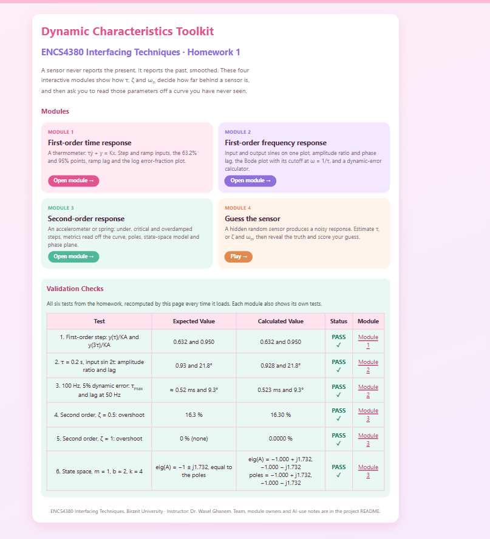
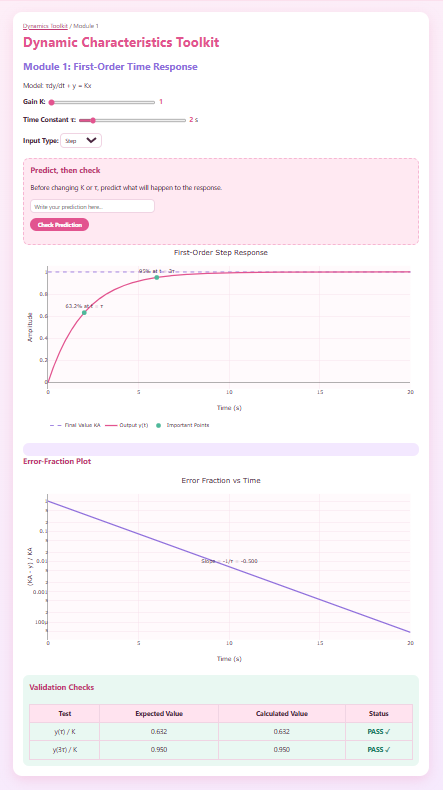
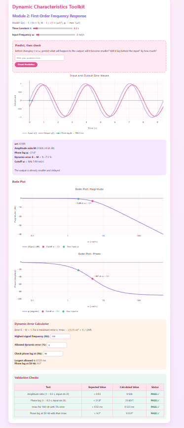
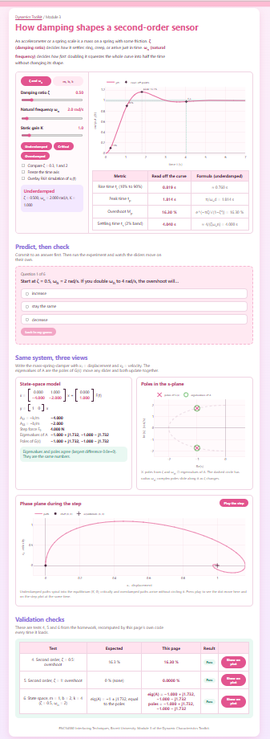
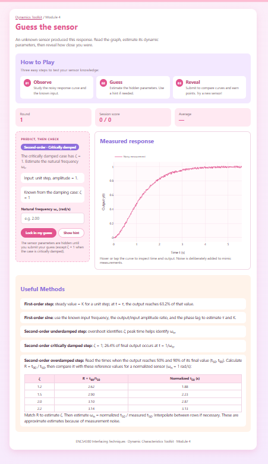

# Dynamic Characteristics Toolkit

**ENCS4380 Interfacing Techniques · Homework 1 · Birzeit University**
Instructor: Dr. Wasel Ghanem

An interactive web toolkit that shows how a sensor's dynamic characteristics (τ, ζ and ωn) decide how far behind the real world it is. Everything runs live in the browser: move a slider and every plot redraws instantly.

## 🔗 Live site

**https://github.com/batool2006bsharat-cyber/encs4380-dynamics-Jerry/**

Works on desktop and phone. No server, login or installation needed.

## 👥 Team: ✏️GROUP NAME

| Member | Student ID | Module | GitHub Issue |
|---|---|---|---|
| ✏️ Batool Bsharat | ✏️ | Module 1: First-order time response | #1 |
| ✏️ Hala Qunir     | ✏️1231745 | Module 2: First-order frequency response | #2 |
| ✏️ Basamat Yasin  | ✏️ | Module 3: Second-order response | #3 |
| ✏️ Niveen Antari  | ✏️1232976 | Module 4: Guess the sensor | #4 |

## 📦 What is inside

| File | Content |
|---|---|
| `index.html` | Home page: links to the four modules and all six validation checks |
| `module1.html` | First-order time response |
| `module2.html` | First-order frequency response |
| `module3.html` | Second-order response and state-space panel |
| `module4.html` | "Guess the sensor" challenge |

### Module 1: First-order time response (thermometer)
Model: τẏ + y = Kx, G(s) = K/(τs + 1)
- Sliders for K and τ, input type step or ramp.
- Step: markers at the 63.2% point (t = τ) and the 95% point (t = 3τ).
- Ramp: ramp lag = τ and steady-state error = Kτ.
- Error-fraction plot (K − y)/K on a log axis: a straight line with slope −1/τ.
- "Predict, then check": 5 multiple-choice questions. After answering, "Run the experiment" moves the sliders on their own to show the result.

### Module 2: First-order frequency response
Model: M = 1/√(1 + (ωτ)²), φ = −tan⁻¹(ωτ)
- Sliders for τ and input frequency ω.
- Input and output sines on one plot, with the time lag marked.
- Amplitude ratio (also in dB), phase lag and dynamic error δ = M − 1.
- Bode magnitude and phase plots with the cutoff marked at ω = 1/τ (−3 dB, −45°).
- Dynamic-error calculator: largest allowed τ for a given frequency and error, and the phase lag at a chosen frequency.

### Module 3: Second-order response (accelerometer, spring)
Model: G(s) = Kωn²/(s² + 2ζωns + ωn²)
- Two parameter sets: ζ, ωn, K, or the physical m, b, k.
- Underdamped, critically damped and overdamped presets, plus an overlay comparing ζ = 0.3, 1 and 2.
- Rise time, peak time, overshoot and settling time **read off the sampled curve**, shown next to the textbook formulas.
- Poles in the s-plane, moving along the circle of radius ωn as ζ changes.
- **State-space panel**: A and B update live; the eigenvalues of A are plotted on top of the poles to show they are the same numbers; phase plane (x₁, x₂) of the step response (a spiral when underdamped, no spiral when overdamped), with a play button that animates the step.
- "Predict, then check": 6 questions, each with an experiment that moves the sliders.

### Module 4: "Guess the sensor" challenge
- A random hidden sensor: first order (K, τ) with a step or sine input, or second order (ζ, ωn), underdamped, critically damped or overdamped, with a step input.
- Noise is added to the response, as in a real measurement.
- The user estimates the parameters; hints are available on request.
- The reveal overlays the true response and the guessed response on the measurement and scores each parameter: within 10% earns full marks.
- "New sensor" starts another round, with a running score for the session.
- A "Useful methods" panel explains how to read each parameter off the curve.

## ✅ Validation checks

All six checks are recomputed by the page's own code every time it loads. They are shown on the home page and in each module.

| # | Test | Expected | Toolkit | Result |
|---|---|---|---|---|
| 1 | First-order step: y(τ)/KA and y(3τ)/KA | 0.632 and 0.950 | 0.632 and 0.950 | ✅ Pass |
| 2 | τ = 0.2 s, input sin 2t: amplitude ratio and lag | 0.93 and 21.8° | 0.928 and 21.8° | ✅ Pass |
| 3 | 100 Hz with 5% dynamic error: τmax and lag at 50 Hz | ≈ 0.52 ms and 9.3° | 0.523 ms and 9.3° | ✅ Pass |
| 4 | Second order, ζ = 0.5: overshoot | 16.3 % | 16.30 % | ✅ Pass |
| 5 | Second order, ζ = 1: overshoot | 0 % | 0.0000 % | ✅ Pass |
| 6 | State space, m = 1, b = 2, k = 4 | eig(A) = −1 ± j1.732, equal to the poles | −1.000 ± j1.732 for both | ✅ Pass |

## ⭐ Bonus: our own ODE solver

Module 3 includes an RK4 solver for ẋ = Ax + BF. The "Overlay RK4 simulation" checkbox plots the RK4 result on top of the closed-form step response, and the phase-plane path and its animation are computed from the same RK4 simulation.

## 📸 Screenshots

| Home | Module 1 |
|---|---|
|  |  |

| Module 2 | Module 3 |
|---|---|
|  |  |

| Module 4 |
|---|
|  |

## 🛠️ Technical notes

- Plain HTML, CSS and JavaScript, hosted as a static site on GitHub Pages.
- Plots use [Plotly.js](https://plotly.com/javascript/) 2.35.2, loaded from its CDN.
- All responses are the closed-form solutions from the lecture slides, computed live in the browser.
- To run locally, open `index.html` in a browser (an internet connection is needed to load Plotly).

## 🤖 AI use

AI coding assistants were allowed for this homework. We used them for:
